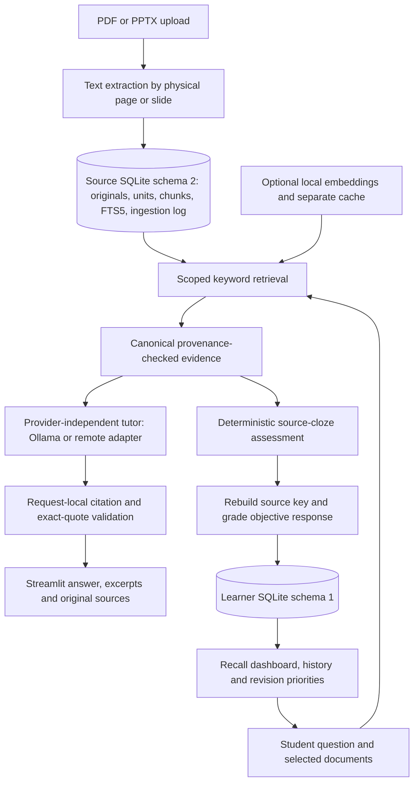

# TutorTrace AI — final submission architecture

Release scope: Milestones 1–3, verified 14 October 2026. No Milestone 4 changes.
Python 3.11, Streamlit, SQLite/FTS5, PyMuPDF, python-pptx; pytest for verification.

## Components and data flow

| Responsibility | Implementation |
|---|---|
| Upload/extraction and original PDF rendering | `tutortrace/ingestion/` |
| Source storage, migration and provenance | `tutortrace/persistence.py`, `models.py` |
| Chunking, FTS5, context selection, optional hybrid search | `tutortrace/retrieval/` |
| Provider contracts, status, HTTP errors and timeouts | `tutortrace/providers/` |
| Grounded answer contract and validation | `tutortrace/tutoring.py` |
| Source-derived questions and key verification | `tutortrace/assessment.py` |
| Learner persistence, grading and recommendations | `tutortrace/learning.py` |
| Library, tutor and practice UI | `app.py`, `tutor_ui.py`, `learning_ui.py` |

## Source and inference boundaries

Original-byte SHA-256 identifies documents. Units retain physical PDF page or
PPTX slide numbers. PDF-defined labels are additional metadata, never guesses
from printed text. Chunks stay within a unit and record text offsets and pipeline
version. Evidence is checked using the document's persisted pipeline version.
Identical current-pipeline uploads are no-ops for evidence; older-pipeline uploads
transactionally rebuild extraction and index without changing document identity.

FTS5 uses the same SQLite tokenizer for query and index. Optional local embeddings
add reciprocal-rank fusion and a separate disposable cache. Selection is scoped,
deduplicated and bounded by passage/character limits. Embedding failures visibly
fall back to keywords. This is not complete multilingual retrieval support.

The tutor sends only selected evidence with request-local aliases to a provider.
Returned aliases must belong to that request, quotes must occur exactly in the
excerpt, and canonical chunks are re-resolved before acceptance. The model does
not author filenames, page numbers or source links. Empty retrieval abstains;
malformed/invalid responses and provider failures show explicit errors. A model's
explicit abstention suppresses accompanying claims. Valid quotes can still be
attached to logically incorrect claims: semantic entailment is not guaranteed.

Ollama is local-only; a separate OpenAI-compatible adapter permits HTTPS remote
inference with supplied credentials. No automatic downloads or fabricated fallback
answers exist. Search and deterministic assessment require no model.

## Assessment and learner state

Assessments blank a deterministic source span. MCQs restore it, short answers
match normalized wording, and numerical questions recall a stated finite value
using Decimal equality. Questions, options and keys are rebuilt from the source
before issue, grade and review. A different short-answer wording gets `needs_review`
and no mastery penalty. No semantic grading, novel arithmetic problem generation,
or LLM-authored answer-key acceptance is implemented.

The learner database holds profiles, topic/course identities, verified questions,
sessions, attempts and mastery counts. It is separate from the unchanged source
ledger. Every learner query enforces record ownership; profile selection is not
authentication. One open session is allowed per learner. The last two issued
sessions' facts are withheld, including abandoned quizzes; unseen eligible facts
are preferred. Limited source material can yield fewer questions or exhaustion.

Grading uses an immediate SQLite transaction: attempts, counters and completion
commit together or roll back. Double submissions are rejected. Cached questions
are revalidated. Historical grades survive source reindexing, but retired chunk
IDs fail closed rather than pointing to a different passage. The two databases
do not form a distributed transaction; preserve both when backing up.

## Transparent adaptation

For objectively correct count C and incorrect count I:

`recall estimate = (1 + C) / (2 + C + I)`

This is a Beta(1,1) count-model mean. Initial 50% means unknown. Needs-review
answers do not change the estimate. No fitted parameters, guessing adjustment,
forgetting model, difficulty weighting, or calibration are used; this is not BKT
or a validated probability that a student knows the topic.

First objective practice in each topic/course is diagnostic. Adaptive level is
easy without objective history or below 0.45, hard at >=0.75 with at least three
objective answers, and medium otherwise. Manual choice overrides adaptation.
Levels change blank length, MCQ option count or numerical hints, not an empirically
calibrated cognitive difficulty. Revision prioritizes weaker tracked topics and
explains the estimate and denominator. The existing tutor receives the chosen
topic, course and practice level. Prerequisites are shown only from explicitly
recognized source statements; no general prerequisite graph is inferred.

## Operational limits

Loopback-only Streamlit; no hosted service, login, encryption, multi-tenant security,
or production deployment. Uploaded originals, learner names and responses remain
in local databases. Remote inference sends the question and selected excerpts to
the chosen provider. PDF/PPTX text support is not video, OCR or diagram reasoning.
See [learning contract](LEARNING_MODEL.md), [limitations](KNOWN_LIMITATIONS.md),
and [final evaluation](FINAL_EVALUATION.md).
